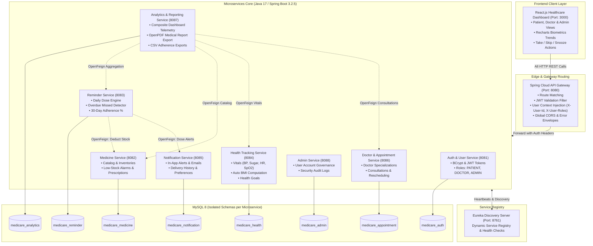
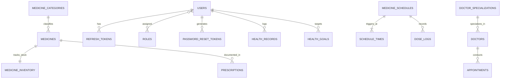

# 🏥 MediCare – Enterprise Smart Medicine Reminder & Health Tracker

[](https://adoptium.net/)
[](https://spring.io/projects/spring-boot)
[](https://spring.io/projects/spring-cloud)
[](https://react.dev/)
[](https://www.mysql.com/)
[](https://tailwindcss.com/)
[](https://docs.docker.com/compose/)

**MediCare** is an enterprise-grade, distributed healthcare management platform designed with **Microservices Architecture**, **Database-per-Service** isolation, **Spring Cloud API Gateway & Eureka Service Discovery**, and a modern **React.js (Tailwind CSS + Recharts)** frontend.

It automates patient medication adherence tracking with interactive **Take / Skip / Snooze** actions, automated missed dose alerts, vital signs monitoring (Blood Pressure, Glucose, Heart Rate, SpO2, Temperature, Sleep, Hydration), automatic **BMI calculation**, doctor consultation scheduling, and **PDF / CSV clinical report downloads**.

---

## 🏛 1. Microservices Architecture Diagram



---

## 🔌 2. Service Port & Routing Mapping

| Microservice | Port | Database Schema | Gateway Path Route | Swagger UI Route |
| :--- | :---: | :--- | :--- | :--- |
| **API Gateway** | `8080` | None | `/` (Edge Ingress) | `http://localhost:8080/actuator` |
| **Eureka Server** | `8761` | None | Service Registry | `http://localhost:8761` |
| **Auth & User Service** | `8081` | `medicare_auth` | `/api/v1/auth/**`, `/api/v1/users/**` | `http://localhost:8081/swagger-ui.html` |
| **Medicine Service** | `8082` | `medicare_medicine` | `/api/v1/medicines/**`, `/api/v1/categories/**`, `/api/v1/inventory/**` | `http://localhost:8082/swagger-ui.html` |
| **Reminder Service** | `8083` | `medicare_reminder` | `/api/v1/schedules/**`, `/api/v1/doses/**` | `http://localhost:8083/swagger-ui.html` |
| **Health Tracking Service** | `8084` | `medicare_health` | `/api/v1/health/**`, `/api/v1/goals/**` | `http://localhost:8084/swagger-ui.html` |
| **Notification Service** | `8085` | `medicare_notification` | `/api/v1/notifications/**`, `/api/v1/notification-preferences/**` | `http://localhost:8085/swagger-ui.html` |
| **Doctor & Appointment** | `8086` | `medicare_appointment` | `/api/v1/doctors/**`, `/api/v1/appointments/**` | `http://localhost:8086/swagger-ui.html` |
| **Analytics & Reports** | `8087` | `medicare_analytics` | `/api/v1/analytics/**`, `/api/v1/reports/**` | `http://localhost:8087/swagger-ui.html` |
| **Admin Service** | `8088` | `medicare_admin` | `/api/v1/admin/**` | `http://localhost:8088/swagger-ui.html` |
| **React Web Application**| `3000` | N/A (Frontend) | Web UI | `http://localhost:3000` |

---

## 🗄 3. Database ER Model & Schema Design

Each service maintains strict schema isolation. Cross-database foreign keys are prohibited; cross-boundary coordination is handled via entity IDs and OpenFeign REST communication.



---

## 🔑 4. Demo Login Credentials

The database seed script (`database/seed-data.sql`) pre-loads realistic healthcare records and test accounts:

| Role | Email Address | Password | Permissions |
| :--- | :--- | :--- | :--- |
| **Patient** | `john.doe@medicare.com` | `Password@123` | Active medicines, dose reminders, vital logs, booking doctors, PDF clinical exports |
| **Doctor** | `dr.sarah.connor@medicare.com` | `Password@123` | Patient consultation schedule, appointment reviews, medical notes |
| **Admin** | `admin@medicare.com` | `Password@123` | Platform oversight, system audit trail, account activate/deactivate governance |

---

## 🚀 5. How to Run Locally

### Prerequisites
1. **Java 17 or 21**
2. **Node.js 18+** & **npm**
3. **MySQL 8.0+** running on `localhost:3306` (or Docker)
4. **Apache Maven 3.8+**

### Step 1: Initialize Database Schemas & Seed Data
Execute the provided initialization SQL scripts in your MySQL 8 instance:
```bash
mysql -u root -p < database/init-schemas.sql
mysql -u root -p < database/seed-data.sql
```

### Step 2: Build All Spring Boot Microservices
From the project root:
```bash
cd backend
mvn clean install -DskipTests
```

### Step 3: Start the Backend Services (Recommended Order)
Launch the microservices in separate terminal windows:
1. **Eureka Server**:
   ```bash
   cd backend/eureka-server && mvn spring-boot:run
   ```
   *(Verify Eureka registry is online at `http://localhost:8761`)*

2. **API Gateway**:
   ```bash
   cd backend/api-gateway && mvn spring-boot:run
   ```
   *(Edge router online at `http://localhost:8080`)*

3. **Core Microservices**:
   ```bash
   cd backend/auth-service && mvn spring-boot:run
   cd backend/medicine-service && mvn spring-boot:run
   cd backend/reminder-service && mvn spring-boot:run
   cd backend/health-service && mvn spring-boot:run
   cd backend/notification-service && mvn spring-boot:run
   cd backend/appointment-service && mvn spring-boot:run
   cd backend/analytics-service && mvn spring-boot:run
   cd backend/admin-service && mvn spring-boot:run
   ```

### Step 4: Start the React Frontend Application
```bash
cd frontend
npm install
npm run dev
```
Open **`http://localhost:3000`** in your browser.

---

## 🐳 6. Multi-Container Docker Deployment

To launch the entire platform (MySQL, Eureka, Gateway, all 8 microservices, and React Frontend) with a single command:

```bash
docker-compose up --build
```

To stop and tear down:
```bash
docker-compose down -v
```

---

## 🧪 7. Running Unit & Integration Tests

The platform includes comprehensive **JUnit 5** and **Mockito** unit tests covering:
- Authentication & JWT generation
- Duplicate user registration guards
- Medicine inventory threshold detection
- Dose action execution (Take / Skip / Snooze)
- Mathematical Adherence rate calculation: $\frac{\text{Taken}}{\text{Scheduled}} \times 100$
- Automatic abnormal biometric detection (Systolic > 140 / Diastolic > 90)

Run all tests:
```bash
cd backend
mvn test
```

---

## 📄 8. License & Notice
Developed for healthcare medication management and adherence tracking.
*Clinical Notice: This software provides personal adherence tracking and health metric logging. It does not replace professional medical diagnosis, prescription advice, or emergency treatment.*
